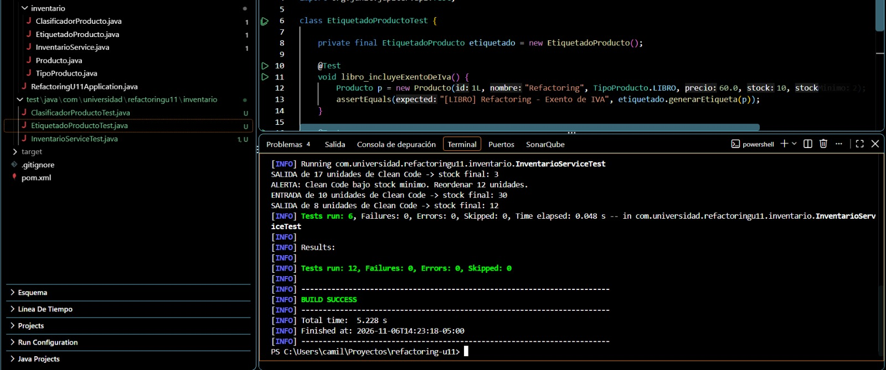
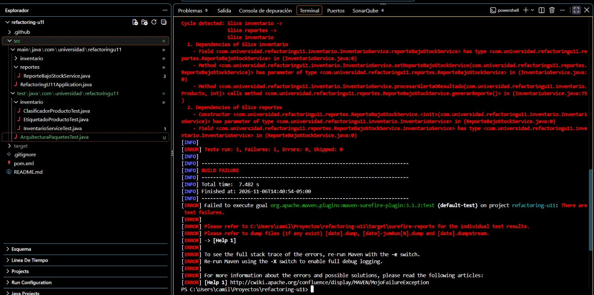
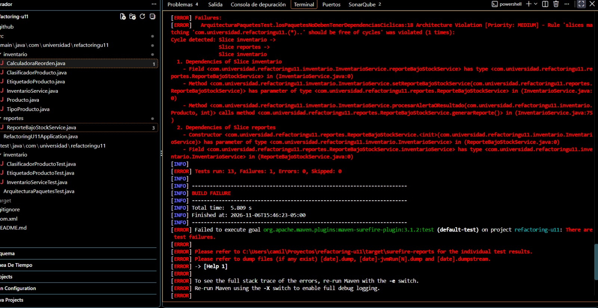
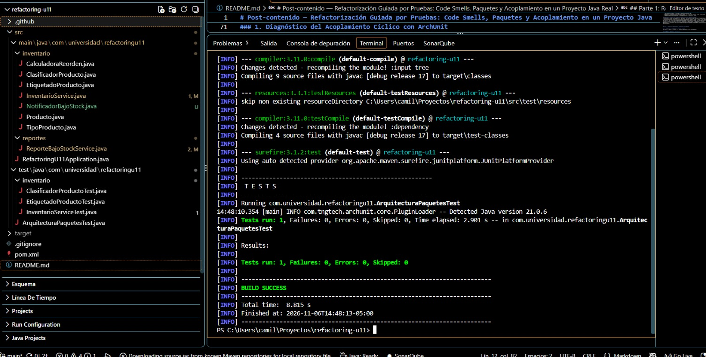
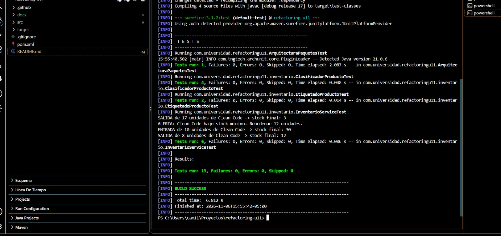

# Post-contenido — Refactorización Guiada por Pruebas: Code Smells, Paquetes y Acoplamiento en un Proyecto Java Real

**Asignatura:** Patrones de Diseño de Software — Universidad de Santander (UDES)
**Unidad 11:** Refactorización Avanzada y Clean Code Profundo
**Estudiante:** Camila Meza
**Repositorio:** [meza-post1-u11](https://github.com/cammeza19/meza-post1-u11)

**Stack:** Java 17 · Spring Boot 3.2.5 (`spring-boot-starter`, sin Web ni Data) · JUnit 5 · ArchUnit 1.3.0 · Maven

---

## Contenido

1. [Cómo ejecutar](#cómo-ejecutar)
2. [Estructura final del proyecto](#estructura-final-del-proyecto)
3. [Historial de commits](#historial-de-commits)
4. [Parte 1 — Red de seguridad y refactorización guiada por evidencia](#parte-1--red-de-seguridad-y-refactorización-guiada-por-evidencia)
5. [Parte 2 — Diagnóstico y resolución de acoplamiento entre paquetes](#parte-2--diagnóstico-y-resolución-de-acoplamiento-entre-paquetes)
6. [Resultado final de la suite de pruebas](#resultado-final-de-la-suite-de-pruebas)
7. [Resumen de las cuatro decisiones de diseño](#resumen-de-las-cuatro-decisiones-de-diseño)

---

## Cómo ejecutar

```bash
# Suite completa (13 pruebas: 12 de caracterización + 1 de arquitectura)
mvn test

# Solo la prueba de arquitectura
mvn test -Dtest=ArquitecturaPaquetesTest
```

---

## Estructura final del proyecto

```text
refactoring-u11/
├── pom.xml
└── src/
    ├── main/java/com/universidad/refactoringu11/
    │   ├── RefactoringU11Application.java
    │   ├── inventario/                        ← dominio (mayor nivel de abstracción)
    │   │   ├── Producto.java
    │   │   ├── TipoProducto.java              ← enum polimórfico (reemplaza los switch)
    │   │   ├── InventarioService.java         ← orquestador de 10 líneas
    │   │   ├── CalculadoraReorden.java        ← política de reorden extraída (SRP)
    │   │   ├── ClasificadorProducto.java      ← delega en TipoProducto
    │   │   ├── EtiquetadoProducto.java        ← delega en TipoProducto
    │   │   └── NotificadorBajoStock.java      ← abstracción (DIP)
    │   └── reportes/                          ← detalle / soporte (menor nivel)
    │       └── ReporteBajoStockService.java   ← implementa NotificadorBajoStock
    └── test/java/com/universidad/refactoringu11/
        ├── ArquitecturaPaquetesTest.java      ← ArchUnit: beFreeOfCycles()
        └── inventario/
            ├── InventarioServiceTest.java     ← 6 pruebas de caracterización
            ├── ClasificadorProductoTest.java  ← 4 pruebas de caracterización
            └── EtiquetadoProductoTest.java    ← 2 pruebas de caracterización
```

---

## Historial de commits

| # | Commit | Parte | Propósito |
|:-:|:---|:-:|:---|
| 1 | `feat: crear inventario con Long Method en InventarioService y switch duplicado en Clasificador/Etiquetado` | 1 | Código original con los dos code smells intencionales |
| 2 | `test: agregar pruebas de caracterizacion antes de refactorizar (red de seguridad)` | 1 | Red de seguridad escrita **antes** de tocar el código |
| 3 | `refactor: eliminar Long Method en actualizarInventario descomponiendo responsabilidades` | 1 | Smell 1 resuelto |
| 4 | `refactor: eliminar switch duplicado sobre TipoProducto con polimorfismo` | 1 | Smell 2 resuelto |
| 5 | `docs: documentar evidencia de code smells, decisiones de diseno y resultado de pruebas` | 1 | README Parte 1 |
| 6 | `feat: agregar modulo de reportes con notificacion de bajo stock desde inventario` | 2 | Introduce el ciclo `inventario ⇄ reportes` |
| 7 | `test: agregar prueba de arquitectura que detecta ciclo entre inventario y reportes (en rojo)` | 2 | Diagnóstico: ArchUnit en **rojo** |
| 8 | `refactor: invertir la dependencia entre inventario y reportes extrayendo NotificadorBajoStock` | 2 | Ciclo resuelto con DIP: ArchUnit en **verde** |
| 9 | `docs: agregar capturas de pantalla de evidencias al README` | 2 | Evidencias visuales |
| 10 | `refactor: limpiar comentarios residuales, sellar CalculadoraReorden y romper ciclo de beans con @Lazy` | 2 | Limpieza final de estilo y corrección del ciclo de beans de Spring |
| 11 | `docs: completar README con diagrama de paquetes antes/despues y decisiones de la Parte 2` | 2 | README consolidado final |

Las pruebas de caracterización (`src/test/.../inventario/`) **no se modificaron** después del commit 2. Se puede verificar con:

```bash
git diff ce1ed72 HEAD -- src/test/java/com/universidad/refactoringu11/inventario
# (salida vacía = sin modificaciones)
```

---

## Parte 1 — Red de seguridad y refactorización guiada por evidencia

### 1.1 Red de seguridad: pruebas de caracterización (antes de refactorizar)

Antes de modificar `InventarioService`, `ClasificadorProducto` o `EtiquetadoProducto` se escribieron 12 pruebas que documentan el comportamiento **actual** del código original. Se instancian con `new` (sin levantar el contexto de Spring) para que sean rápidas e independientes de la inyección de dependencias.

| Clase de prueba | Pruebas | Comportamiento cubierto |
|:---|:-:|:---|
| `InventarioServiceTest` | 6 | `OK_<stock>` por ENTRADA y por SALIDA · `ERROR_DATOS_INVALIDOS` · `ERROR_PRODUCTO_NO_EXISTE` · `ERROR_STOCK_INSUFICIENTE` (sin modificar el stock) · `OK_BAJO_STOCK_REORDEN_12` (reorden calculado) |
| `ClasificadorProductoTest` | 4 | Las 4 ramas de `calcularRecargoEnvio`: LIBRO (0), ELECTRONICO (8 %), ROPA (3 %), ALIMENTO (2.50 fijo) |
| `EtiquetadoProductoTest` | 2 | `generarEtiqueta` para LIBRO y ELECTRONICO |
| **Total** | **12** | |

**Resultado sobre el código original (sin refactorizar):**

```text
[INFO] Tests run: 6, Failures: 0, Errors: 0, Skipped: 0 -- in com.universidad.refactoringu11.inventario.InventarioServiceTest
[INFO] Results:
[INFO] Tests run: 12, Failures: 0, Errors: 0, Skipped: 0
[INFO] BUILD SUCCESS
[INFO] Finished at: 2026-11-06T14:23:18-05:00
```

La ejecución terminó a las 14:23:18, un minuto **antes** del commit de las pruebas (14:24:21) y antes del primer commit de refactorización (14:27:28).



---

### 1.2 Smell 1 — Long Method (Bloater) en `InventarioService.actualizarInventario()`

**Diagnóstico.** El método original mezclaba cinco responsabilidades en un solo bloque:

1. Validación de los datos de entrada.
2. Búsqueda del producto en la colección.
3. Validación de existencias y actualización del stock.
4. Cálculo de la necesidad y la cantidad de reorden.
5. Registro de auditoría y emisión de la alerta.

**Técnicas de Fowler aplicadas:** *Extract Method* (seis métodos privados con nombres que revelan intención), *Extract Class* (`CalculadoraReorden`) y *Replace Nested Conditional with Guard Clauses* (las tres salidas de error se resuelven al inicio, sin anidamiento).

**Método resultante (10 líneas, firma y llave de cierre incluidas):**

```java
public String actualizarInventario(Long productoId, int cantidad, String tipoMovimiento) {
    if (esEntradaInvalida(productoId, cantidad, tipoMovimiento)) return "ERROR_DATOS_INVALIDOS";
    Producto producto = buscarProducto(productoId);
    if (producto == null) return "ERROR_PRODUCTO_NO_EXISTE";
    if (esStockInsuficiente(producto, cantidad, tipoMovimiento)) return "ERROR_STOCK_INSUFICIENTE";

    int nuevoStock = aplicarMovimiento(producto, cantidad, tipoMovimiento);
    registrarAuditoria(tipoMovimiento, cantidad, producto, nuevoStock);
    return procesarAlertaOResultado(producto, nuevoStock);
}
```

**Evidencia medible:**

| Métrica de `actualizarInventario()` | Antes | Después |
|:---|:-:|:-:|
| Líneas físicas (firma a llave de cierre) | 45 | 10 |
| Líneas no vacías | 38 | 9 |
| Complejidad ciclomática (McCabe) | 12 | 4 |
| Niveles máximos de anidamiento | 2 | 0 |
| Responsabilidades mezcladas | 5 | 1 (orquestación) |
| Métodos privados extraídos | 0 | 6 |
| Clases colaboradoras | 0 | 1 (`CalculadoraReorden`) |

Métodos extraídos y su responsabilidad única:

| Método / clase | Responsabilidad |
|:---|:---|
| `esEntradaInvalida(...)` | Validar los parámetros de entrada |
| `buscarProducto(...)` | Localizar el producto por id |
| `esStockInsuficiente(...)` | Verificar que una SALIDA no deje stock negativo |
| `aplicarMovimiento(...)` | Calcular y asignar el nuevo stock |
| `registrarAuditoria(...)` | Registrar el movimiento |
| `procesarAlertaOResultado(...)` | Notificar el bajo stock y construir el código de retorno |
| `CalculadoraReorden` | Política de reorden (`stockMinimo * 3 - stockActual`) |

> **Nota de transparencia.** Durante la extracción, las comparaciones `tipoMovimiento.equals("ENTRADA")` se escribieron como `"ENTRADA".equals(tipoMovimiento)` (forma *null-safe*). Para todos los valores cubiertos por la red de seguridad el comportamiento es idéntico; la única diferencia es que un `tipoMovimiento` nulo ahora retorna `ERROR_DATOS_INVALIDOS` en lugar de lanzar `NullPointerException`.

**Resultado tras el refactor:** `Tests run: 12, Failures: 0, Errors: 0, Skipped: 0` — sin modificar ninguna prueba.

---

### 1.3 Smell 2 — Switch Statements duplicados (Object-Orientation Abuser)

**Diagnóstico.** `ClasificadorProducto.calcularRecargoEnvio()` y `EtiquetadoProducto.generarEtiqueta()` contenían el mismo `switch` sobre `TipoProducto`, con los mismos cuatro `case` y el mismo `default` que lanzaba `IllegalArgumentException`. Agregar un tipo nuevo obligaba a modificar ambas clases (*Shotgun Surgery*), lo que viola el principio Open/Closed.

**Técnica de Fowler aplicada:** *Replace Conditional with Polymorphism*, implementada con métodos abstractos en el enum y una implementación por constante (*constant-specific method implementation*).

```java
public enum TipoProducto {
    LIBRO {
        public double calcularRecargoEnvio(double precio) { return 0.0; }
        public String formatearEtiqueta(String nombre) { return "[LIBRO] " + nombre + " - Exento de IVA"; }
    },
    // ELECTRONICO, ROPA, ALIMENTO ...
    ;
    public abstract double calcularRecargoEnvio(double precio);
    public abstract String formatearEtiqueta(String nombre);
}
```

Las clases cliente conservan **exactamente** su firma pública original y solo delegan:

```java
public double calcularRecargoEnvio(Producto producto) {
    return producto.getTipo().calcularRecargoEnvio(producto.getPrecio());
}

public String generarEtiqueta(Producto producto) {
    return producto.getTipo().formatearEtiqueta(producto.getNombre());
}
```

**Evidencia medible:**

| Métrica | Antes | Después |
|:---|:-:|:-:|
| Sentencias `switch` sobre `TipoProducto` | 2 | 0 |
| Etiquetas `case` duplicadas entre clases | 4 de 4 (100 %) + `default` | 0 (0 %) |
| Cadenas `if-else` sobre `TipoProducto` | 0 | 0 |
| Clases a modificar al agregar un tipo nuevo | 2 (`ClasificadorProducto`, `EtiquetadoProducto`) | 0 (solo se agrega la constante al enum) |
| Líneas del cuerpo de cada método cliente | 8 | 1 |
| Ramas `default` de error en tiempo de ejecución | 2 | 0 (el compilador obliga a implementar los métodos abstractos) |

Verificación de que no queda ningún `switch`:

```bash
grep -rn "switch" src/main/java   # sin resultados
```

**Resultado tras el refactor:** `Tests run: 12, Failures: 0, Errors: 0, Skipped: 0` — sin modificar ninguna prueba.

---

### 1.4 Decisiones de diseño de la Parte 1

#### Decisión de diseño 1 — `CalculadoraReorden` como clase colaboradora, no como método privado

- **Elección:** extraer el cálculo de reorden a la clase independiente `CalculadoraReorden`.
- **Pregunta guía:** ¿la lógica tiene una razón de cambio propia, distinta de la del resto del servicio?
- **Respuesta: sí.** La fórmula `stockMinimo * 3 - stockActual` es una **política de reabastecimiento** que pertenece a compras y logística. Cambiará por motivos ajenos al registro de movimientos de inventario: stock de seguridad variable, tiempos de entrega del proveedor, estacionalidad o lotes mínimos de compra. `InventarioService` solo debe cambiar si cambia la forma de registrar entradas y salidas.
- **Consecuencias:**
  1. **SRP:** cada clase tiene una sola razón de cambio.
  2. **Evolución aislada:** una nueva política de reorden se implementa en `CalculadoraReorden` sin tocar el servicio ni sus pruebas.
  3. **Testabilidad:** la fórmula se puede probar de forma directa, sin preparar productos ni movimientos.
- **Alternativa descartada:** un método privado sería suficiente si la fórmula fuera trivial y estable. Pero dejaría la regla de negocio oculta dentro del servicio y obligaría a modificar `InventarioService` cada vez que cambie la política.

#### Decisión de diseño 2 — Enum polimórfico en lugar de una jerarquía *Strategy*

- **Elección:** `TipoProducto` como enum con un método abstracto por comportamiento y una implementación por constante.
- **Justificación:**
  1. **Conjunto cerrado y estable.** Los tipos de producto (LIBRO, ELECTRONICO, ROPA, ALIMENTO) forman una taxonomía cerrada en este dominio. El enum la modela de forma natural y el compilador obliga a que cada constante nueva implemente **todos** los comportamientos, lo que elimina las ramas `default` que fallaban en tiempo de ejecución.
  2. **Sin colaboradores externos.** El recargo y la etiqueta dependen solo de datos del propio producto (precio y nombre). Ningún tipo necesita repositorios, servicios ni beans inyectados por Spring.
  3. **Costo frente a beneficio.** Una interfaz *Strategy* con cuatro clases concretas, más un mapa o *factory* para resolverlas, agregaría al menos cinco archivos sin ningún beneficio actual (*Speculative Generality*).
- **Cuándo cambiaría a *Strategy*:** si en el futuro cada tipo necesitara colaboradores inyectados por Spring (por ejemplo, un servicio de tarifas de transporte para ELECTRONICO o un servicio de vencimientos para ALIMENTO), o si los tipos se definieran por configuración o base de datos en lugar de código. En ese caso, una interfaz con una implementación `@Component` por tipo sería la opción correcta.

---

## Parte 2 — Diagnóstico y resolución de acoplamiento entre paquetes

### 2.1 Introducción del módulo de reportes y diagnóstico del ciclo

Al integrar el paquete `reportes`, `InventarioService` empezó a notificar el bajo stock invocando directamente a `ReporteBajoStockService`, que a su vez recibe `InventarioService` por constructor. El proyecto compilaba y las 12 pruebas de negocio seguían en verde: **el problema no era de comportamiento sino de arquitectura.**

#### Diagrama de paquetes ANTES (con ciclo)

```text
┌──────────────────────────────────────────┐
│           paquete: inventario            │
│                                          │
│   InventarioService                      │
│     - reporteBajoStockService (campo)    │
│     - setReporteBajoStockService(...)    │
└──────────┬───────────────────────▲───────┘
           │                       │
           │ (1) importa y usa     │ (2) importa y usa
           │ ReporteBajoStock-     │ InventarioService
           │ Service               │
           ▼                       │
┌──────────────────────────────────┴───────┐
│            paquete: reportes             │
│                                          │
│   ReporteBajoStockService                │
│     - inventarioService (constructor)    │
└──────────────────────────────────────────┘

        CICLO: inventario → reportes → inventario
```

#### Evidencia: `ArquitecturaPaquetesTest` en ROJO

```text
$ mvn test -Dtest=ArquitecturaPaquetesTest

Architecture Violation [Priority: MEDIUM] - Rule 'slices matching 'com.universidad.refactoringu11.(*)..' should be free of cycles' was violated (1 times):
Cycle detected: Slice inventario ->
                Slice reportes ->
                Slice inventario
  1. Dependencies of Slice inventario
    - Field <com.universidad.refactoringu11.inventario.InventarioService.reporteBajoStockService> has type <com.universidad.refactoringu11.reportes.ReporteBajoStockService> in (InventarioService.java:0)
    - Method <com.universidad.refactoringu11.inventario.InventarioService.setReporteBajoStockService(com.universidad.refactoringu11.reportes.ReporteBajoStockService)> has parameter of type <com.universidad.refactoringu11.reportes.ReporteBajoStockService> in (InventarioService.java:0)
    - Method <com.universidad.refactoringu11.inventario.InventarioService.procesarAlertaOResultado(com.universidad.refactoringu11.inventario.Producto, int)> calls method <com.universidad.refactoringu11.reportes.ReporteBajoStockService.generarReporte()> in (InventarioService.java:75)
  2. Dependencies of Slice reportes
    - Constructor <com.universidad.refactoringu11.reportes.ReporteBajoStockService.<init>(com.universidad.refactoringu11.inventario.InventarioService)> has parameter of type <com.universidad.refactoringu11.inventario.InventarioService> in (ReporteBajoStockService.java:0)
    - Field <com.universidad.refactoringu11.reportes.ReporteBajoStockService.inventarioService> has type <com.universidad.refactoringu11.inventario.InventarioService> in (ReporteBajoStockService.java:0)

[ERROR] Tests run: 1, Failures: 1, Errors: 0, Skipped: 0
[INFO] BUILD FAILURE
```

**Lectura del diagnóstico:** ArchUnit encontró **3 dependencias** de `inventario` hacia `reportes` (campo, parámetro del setter y llamada a `generarReporte()`) y **2** en sentido contrario (parámetro del constructor y campo). Las dos flechas en sentidos opuestos forman el ciclo.



#### Las pruebas de negocio siguen en verde a pesar del ciclo

Ejecutando la suite completa en el commit de la prueba en rojo (`git checkout debc02e && mvn test`), las 12 pruebas de caracterización pasan y solo falla la de arquitectura. Esto confirma que el *smell* es estructural y que ninguna prueba de comportamiento lo habría detectado:

```text
[ERROR] Tests run: 13, Failures: 1, Errors: 0, Skipped: 0
        → 12 pruebas de caracterización en verde + 1 ArquitecturaPaquetesTest en rojo
```



---

### 2.2 Resolución mediante inversión de dependencias (DIP)

Se extrajo la abstracción `NotificadorBajoStock` **dentro del paquete `inventario`**:

```java
package com.universidad.refactoringu11.inventario;

public interface NotificadorBajoStock {
    void notificar(Producto producto, int cantidadReorden);
}
```

- `InventarioService` depende solo de la interfaz (inyección opcional por setter con `@Autowired(required = false)`, para no alterar el constructor sin argumentos que usan las pruebas de la Parte 1).
- `ReporteBajoStockService` **implementa** `NotificadorBajoStock` y acumula las alertas recibidas para su reporte.
- `InventarioService` ya no contiene ningún `import com.universidad.refactoringu11.reportes.*`.

> **Ciclo a nivel de beans (commit 10).** Al eliminar el ciclo entre paquetes queda un ciclo distinto, en tiempo de ejecución, entre beans de Spring: `ReporteBajoStockService` recibe `InventarioService` por constructor, e `InventarioService` recibe el `NotificadorBajoStock` por setter. Spring Boot 3 prohíbe por defecto las referencias circulares, así que se anotó el parámetro del constructor con `@Lazy`: Spring inyecta un proxy que resuelve `InventarioService` en su primer uso. Esto no afecta la dirección de las dependencias de paquetes (`reportes → inventario`), por lo que `ArquitecturaPaquetesTest` sigue en verde.

#### Diagrama de paquetes DESPUÉS (sin ciclo)

```text
┌─────────────────────────────────────────────────────────┐
│                  paquete: inventario                    │
│                    (dominio, alto nivel)                │
│                                                         │
│   InventarioService ───usa───▶ «interface»              │
│                                NotificadorBajoStock     │
│                                  + notificar(Producto,  │
│                                    int cantidadReorden) │
└──────────────────▲─────────────────────▲────────────────┘
                   │                     │
                   │ usa                 │ implementa
                   │ InventarioService   │ NotificadorBajoStock
                   │                     │
┌──────────────────┴─────────────────────┴────────────────┐
│                   paquete: reportes                     │
│                  (detalle, bajo nivel)                  │
│                                                         │
│  ReporteBajoStockService implements NotificadorBajoStock│
└─────────────────────────────────────────────────────────┘

   Única dirección: reportes → inventario   (inventario → reportes: 0 dependencias)
```

Verificación de que el dominio no conoce a reportes:

```bash
grep -rn "import com.universidad.refactoringu11.reportes" src/main/java/com/universidad/refactoringu11/inventario
# sin resultados
```

#### Evidencia: `ArquitecturaPaquetesTest` en VERDE

```text
$ mvn test -Dtest=ArquitecturaPaquetesTest

[INFO] Running com.universidad.refactoringu11.ArquitecturaPaquetesTest
[INFO] Tests run: 1, Failures: 0, Errors: 0, Skipped: 0, Time elapsed: 2.901 s -- in com.universidad.refactoringu11.ArquitecturaPaquetesTest
[INFO] Results:
[INFO] Tests run: 1, Failures: 0, Errors: 0, Skipped: 0
[INFO] BUILD SUCCESS
[INFO] Finished at: 2026-11-06T14:48:13-05:00
```



| Métrica de acoplamiento | Antes | Después |
|:---|:-:|:-:|
| Dependencias `inventario → reportes` (según ArchUnit) | 3 | 0 |
| Dependencias `reportes → inventario` | 2 | Se mantienen (única dirección permitida: `implements`, constructor, campo, uso de `Producto`) |
| Ciclos entre paquetes | 1 | 0 |
| Imports de `reportes` dentro de `inventario` | 1 | 0 |

---

### 2.3 Decisiones de diseño de la Parte 2

#### Decisión de diseño 3 — `NotificadorBajoStock` vive en `inventario`, no en `reportes`

- **Elección:** la interfaz se declara en el paquete `inventario`.
- **Regla aplicada (Guía de Contenido, sección 4.3):** *"los paquetes de infraestructura dependen de dominio; dominio nunca depende de infraestructura".*
- **¿Cuál paquete es el de mayor nivel de abstracción?** `inventario`. Contiene las entidades (`Producto`, `TipoProducto`) y las reglas de negocio (movimientos de stock, política de reorden) que justifican la existencia del sistema. `reportes` es un **detalle**: una forma, entre muchas posibles, de reaccionar a un evento del dominio (mañana podría ser un correo, una cola de mensajes o un webhook).
- **Justificación (DIP y Clean Architecture):**
  1. El módulo de alto nivel **define y es dueño** del contrato que necesita: `InventarioService` declara cómo quiere ser notificado; no se adapta a la API de quien lo escucha.
  2. El módulo de bajo nivel **implementa** ese contrato. Así, la dependencia de código fuente apunta hacia el dominio, aunque el flujo de control en tiempo de ejecución vaya de inventario a reportes.
  3. **Si la interfaz estuviera en `reportes`, el ciclo persistiría:** `inventario` tendría que importar `reportes.NotificadorBajoStock`, y `reportes` seguiría importando `InventarioService`. Solo cambiaría la clase involucrada, no la dirección de la flecha.
  4. **Extensibilidad (OCP):** se pueden agregar nuevos notificadores (`NotificadorEmail`, `NotificadorKafka`) sin modificar el paquete `inventario`.

#### Decisión de diseño 4 — Granularidad por evento: `notificar(Producto, int)` frente a `notificar(List<Producto>)`

- **Elección:** un evento por producto: `void notificar(Producto producto, int cantidadReorden)`.
- **Ventajas en este diseño:**
  1. **Coincide con el punto de detección.** `actualizarInventario()` procesa **un** movimiento de **un** producto; el umbral se cruza en ese instante y para ese producto. Una firma por lote obligaría al servicio a acumular productos en un búfer y a decidir cuándo vaciarlo, lo que agrega estado y una responsabilidad nueva al dominio.
  2. **Transporta el dato calculado.** El parámetro `cantidadReorden` entrega el resultado de `CalculadoraReorden`, así el receptor no tiene que recalcular la política ni conocerla, lo que evita duplicar la regla de negocio. `notificar(List<Producto>)` perdería ese dato.
  3. **Reacción inmediata y contrato mínimo.** La alerta se emite en tiempo real y la interfaz tiene un solo método con datos de dominio, fácil de implementar y de simular en pruebas (*Interface Segregation*).
  4. **El receptor decide si agrupa.** `ReporteBajoStockService` acumula los eventos en su lista `alertas` y los consolida en `generarReporte()`. La agregación queda en el paquete de bajo nivel, que es donde corresponde.
- **Cuándo preferiría una notificación por lote:**
  - En **cargas masivas** (importar un catálogo de miles de productos), donde notificar ítem por ítem saturaría la red, el correo o la cola de mensajes.
  - En **procesos programados** (por ejemplo, un *job* nocturno que genera una única orden de compra consolidada por proveedor).
  - Cuando el canal externo cobra o limita **por llamada** (APIs con *rate limiting*).

---

## Resultado final de la suite de pruebas

Se ejecutó la suite completa en el estado final **sin modificar ninguna línea** de `InventarioServiceTest`, `ClasificadorProductoTest` ni `EtiquetadoProductoTest`:

```text
$ mvn test

[INFO] Tests run: 1,  Failures: 0, Errors: 0, Skipped: 0 -- in com.universidad.refactoringu11.ArquitecturaPaquetesTest
[INFO] Tests run: 4,  Failures: 0, Errors: 0, Skipped: 0 -- in com.universidad.refactoringu11.inventario.ClasificadorProductoTest
[INFO] Tests run: 2,  Failures: 0, Errors: 0, Skipped: 0 -- in com.universidad.refactoringu11.inventario.EtiquetadoProductoTest
[INFO] Tests run: 6,  Failures: 0, Errors: 0, Skipped: 0 -- in com.universidad.refactoringu11.inventario.InventarioServiceTest
[INFO] Results:
[INFO] Tests run: 13, Failures: 0, Errors: 0, Skipped: 0
[INFO] BUILD SUCCESS
```

| Clase de prueba | Resultado |
|:---|:-:|
| `InventarioServiceTest` | 6/6 |
| `ClasificadorProductoTest` | 4/4 |
| `EtiquetadoProductoTest` | 2/2 |
| `ArquitecturaPaquetesTest` | 1/1 |
| **Total** | **13/13** |

> La guía muestra `Tests run: 12` en el Paso 4 de la Parte 2. Aquí el total es 13 porque la suite incluye las 12 pruebas de caracterización **más** `ArquitecturaPaquetesTest`.



### Evolución de la suite a lo largo del laboratorio

| Momento | Caracterización (12) | Arquitectura (1) |
|:---|:-:|:-:|
| Código original (commit 2) | 12/12 | — |
| Tras refactorizar el Long Method (commit 3) | 12/12 | — |
| Tras refactorizar los switch (commit 4) | 12/12 | — |
| Con el módulo de reportes y el ciclo (commit 7) | 12/12 | ciclo detectado |
| Tras invertir la dependencia (commit 8) | 12/12 | sin ciclos |
| Tras la limpieza final (commit 10, estado final) | 12/12 | sin ciclos |

---

## Resumen de las cuatro decisiones de diseño

| # | Parte | Decisión | Elección | Principio |
|:-:|:-:|:---|:---|:---|
| 1 | 1 | ¿Cálculo de reorden como método privado o clase propia? | Clase `CalculadoraReorden` | SRP: la política de reorden tiene su propia razón de cambio |
| 2 | 1 | ¿Enum polimórfico o *Strategy* con clases? | Enum con métodos abstractos por constante | OCP con conjunto cerrado; evita *Speculative Generality* |
| 3 | 2 | ¿Dónde vive `NotificadorBajoStock`? | Paquete `inventario` (dominio) | DIP: la abstracción pertenece al módulo de alto nivel |
| 4 | 2 | ¿Notificación por evento o por lote? | Por evento: `notificar(Producto, int)` | Coincide con el punto de detección; la agregación queda en el receptor |